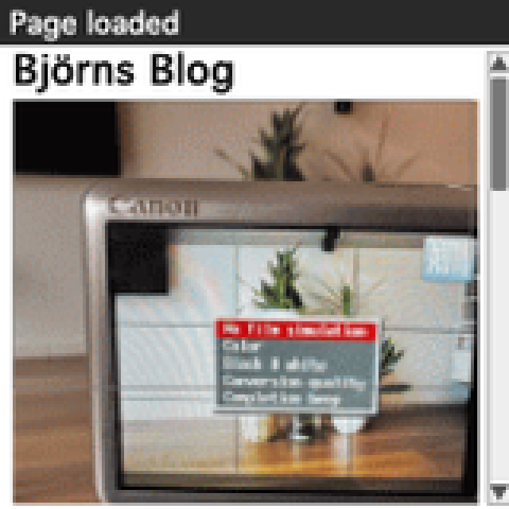
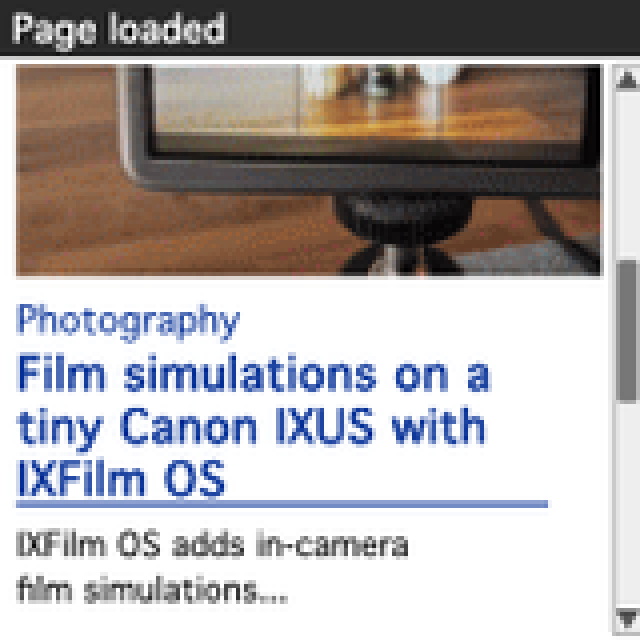

# RetroWEB Browser for Palm OS

RetroWEB Browser is a small, native, open-source web browser for classic Palm
OS handhelds. It can display inline GIF images, which is something I could not
find in other browsers that still run on the colour Palm IIIc. It renders the
first frame of GIF87a/GIF89a images directly on Palm OS 4.0 or 4.1 and uses
[RetroWEB](http://retroweb.bjrno.com/) to convert modern pages and images into
content suitable for old devices.

The browser itself only needs an ordinary Palm network connection and HTTP.
HTTPS, modern HTML and image conversion are handled by RetroWEB.





The screenshots are rendered at the Palm IIIc's native 160 by 160 pixel
resolution and enlarged with nearest-neighbour scaling for display on GitHub.

## Features

- HTTP/1.0 networking through Palm NetLib
- RetroWEB home and search page
- addresses entered in the browser are automatically opened through RetroWEB
- basic HTML 2.0-style text, headings, lists, rules and links
- first-frame GIF87a/GIF89a image support
- temporary Palm-database GIF cache with lazy 8-bit bitmap decoding
- progressive rendering with tappable links and scrolling during downloads
- GET and POST forms
- bookmarks and history
- Back, Forward, Home and Reload commands
- configurable home page, stored separately for each browser profile
- configurable HTTP forwarding proxy, including HTTPS targets through a proxy
- pen-operated scrollbar and hardware Page Up/Page Down support
- explicit Connect and Disconnect commands
- Palm OS 4.0/4.1 and 68K support

This is alpha software developed and tested on physical vintage hardware.

## Install

Download `RetroWEBBrowser.prc` from the latest GitHub release and install it
with Palm Desktop, HotSync or another PRC installer.

The launcher name is **RetroWEB**. Its home page is:

```text
http://retroweb.bjrno.com/
```

The standalone build uses the RetroWEB forwarding proxy at
`retroweb.bjrno.com:8081` by default. Entered HTTP and HTTPS addresses are sent
as ordinary absolute proxy requests; the address shown in the browser remains
the address entered by the user.

The RetroModem companion build, **RBrowser**, uses the same default home page:

```text
http://retroweb.bjrno.com/
```

Its proxy is disabled and its proxy fields are empty by default because
RetroModem normally handles forwarding itself. Both builds can enable or
disable the proxy and configure its host, port and home page under
**Options > Preferences**. Their settings are stored separately.

## Build

The reproducible build uses the PRC-Tools Remix Docker image:

```sh
docker pull --platform linux/amd64 tomari/prc-tools-remix:latest
make docker-build
```

This creates two independent applications:

- `dist/RetroWEBBrowser.prc`: public RetroWEB-powered browser (`RtWB`)
- `dist/RBrowser.prc`: RetroModem companion build (`RwBr`)

Build only one profile with `make retroweb` or `make modem`
inside the toolchain.
The two applications use separate Palm creator IDs and preference databases,
so they can be installed side by side.

## Current limits

- no native HTTPS; RetroWEB performs HTTPS fetching
- GIF only; animated GIFs display their first frame
- inline image count is governed by RetroWEB's device memory budget
- 60 KB response limit
- deliberately small, bounded HTML renderer rather than a full browser engine

## Credits

The initial Palm NetLib socket approach was adapted from
[PalmGET](https://github.com/guruthree/PalmGET) by Fred, under the MIT license.

RetroWEB is created and operated by Björn Heirman.

## License

MIT. See [LICENSE](LICENSE).
